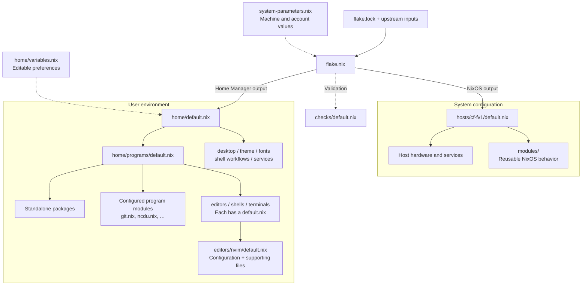

# 🐘 GneshaOS

> NixOS + home-manager configuration, blessed by the elephant.

A declarative NixOS configuration for a [Panasonic Let's Note CF-FV1](https://panasonic.jp/pc/products/letsnote/), running Sway on Wayland with a fully home-managed user environment.

```
⠀⠀⠀⠀⠀⠀⠀⠀⠀⠀⠀⠀⠀⠀⠀⠀⠀⠀⠀⠀⠀⠀⠀⠀⠀⠀⠀⠀⢀⠔⠑⢄⠀⠀⠀⠀⠀⠀⠀⠀⠀⠀⠀⠀⠀⠀⠀⠀⠀⠀⠀⠀⠀⠀⠀⠀⠀⠀⠀⠀
⠀⠀⠀⠀⠀⠀⠀⠀⠀⠀⠀⠀⠀⠀⠀⠀⠀⠀⠀⠀⠀⠀⠀⠀⠀⠀⠀⠀⢘⡤⠤⣜⠀⠀⠀⠀⠀⠀⠀⠀⠀⠀⠀⠀⠀⠀⠀⠀⠀⠀⠀⠀⠀⠀⠀⠀⠀⠀⠀⠀
⠀⠀⠀⠀⠀⠀⠀⠀⠀⠀⠀⠀⠀⠀⠀⠀⠀⠀⠀⠀⠀⠀⠀⠀⠀⠀⢀⠾⠀⠀⠀⠀⠹⢄⠀⠀⠀⠀⠀⠀⠀⠀⠀⠀⠀⠀⠀⠀⠀⠀⠀⠀⠀⠀⠀⠀⠀⠀⠀⠀
⠀⠀⠀⠀⠀⠀⠀⠀⠀⠀⠀⠀⠀⠀⠀⠀⠀⠀⠀⠀⠀⠀⠀⠀⠀⠰⣑⠶⠬⠭⠭⠥⠶⢆⡆⠀⠀⠀⠀⠀⠀⠀⠀⠀⠀⠀⠀⠀⠀⠀⠀⠀⠀⠀⠀⠀⠀⠀⠀⠀
⠀⠀⠀⠀⠀⠀⠀⠀⠀⠀⠀⠀⠀⠀⠀⠀⠀⠀⠀⠀⠀⠀⠀⢀⡤⠐⠊⠉⢩⢼⡹⢉⠉⠑⠓⠤⡀⠀⠀⠀⠀⠀⠀⠀⠀⠀⠀⠀⠀⠀⠀⠀⠀⠀⠀⠀⠀⠀⠀⠀
⠀⠀⠀⠀⠀⠀⠀⠀⠀⠀⠀⠀⠀⠀⠀⠀⠀⠀⠀⠀⠀⠀⡴⣑⠊⠁⠠⡬⠔⢱⡢⠩⠓⣀⠠⠡⢊⢦⠀⠀⠀⠀⠀⠀⠀⠀⠀⠀⠀⠀⠀⠀⠀⠀⠀⠀⠀⠀⠀⠀
⠀⠀⠀⠀⠀⠀⠀⠀⠀⠀⠀⠀⠀⠀⠀⠀⠀⠀⠀⠀⢀⢔⠉⢐⢄⢈⠬⣩⡘⠃⠈⢡⣎⠡⣀⠁⠖⠉⡢⡀⠀⠀⠀⠀⠀⠀⠀⠀⠀⠀⠀⠀⠀⠀⠀⠀⠀⠀⠀⠀
⠀⠀⠀⠀⠀⠀⠀⠀⠀⠀⠀⠀⠀⠀⠀⠀⠀⠀⠀⢀⢎⠤⡐⡮⡐⢃⡇⠸⡑⠁⠈⢊⠇⢈⡼⠐⣺⢢⠈⣧⠀⠀⠀⠀⠀⠀⠀⠀⠀⠀⠀⠀⠀⠀⠀⠀⠀⠀⠀⠀
⠀⠀⠀⠀⠀⠀⠀⠀⠀⠀⠀⠀⠀⠀⠀⠀⠀⠀⠀⣸⠢⡈⣢⠔⡂⠬⠍⠛⢫⠅⠩⡭⠍⠭⠄⢒⠤⡒⣐⠘⡇⠀⠀⠀⠀⠀⠀⠀⠀⠀⠀⠀⠀⠀⠀⠀⠀⠀⠀⠀
⠀⠀⠀⠀⠀⠀⢀⠶⠀⠀⠀⠀⠀⠀⠀⠀⠀⠀⠀⠣⢥⠎⢅⠥⠂⠈⠉⠉⠉⠐⠂⠉⠉⠉⠀⠒⢅⡊⣃⠈⡅⠀⠀⠀⠀⠀⠀⠀⠀⠀⣀⠀⠶⡀⠀⡄⠀⠀⠀⠀
⠀⠀⢀⢠⡄⢀⣓⣲⡁⠀⠀⠀⢀⠔⠂⠈⠁⠐⠢⢴⡓⣱⠇⠀⠀⠀⠀⠀⠀⠀⠀⠀⠀⠀⠀⠀⠀⢳⡴⣱⡣⠔⠒⠒⠒⠤⡀⠀⢖⠴⠀⡞⠀⠘⡀⠱⠂⠇⠀⠀
⠀⡜⠁⠐⢄⣰⠄⡺⡠⢄⠀⡔⢁⠄⠊⠉⠉⠁⠢⡌⢻⠇⠀⠊⠉⠐⣄⠀⠀⠦⠴⠀⠀⡴⠊⠐⠒⠌⣷⠏⠠⠂⠈⠁⠐⢤⠈⢆⠘⡀⢄⢧⠀⠀⢃⠇⡜⠀⠀⠀
⠸⠀⠀⠀⣆⡸⢀⠉⡰⡸⠸⡐⠁⠀⠀⠀⠀⠀⠠⢔⡏⠀⠠⣮⣥⣂⠀⠀⠀⠀⠀⠀⠈⢀⣰⡤⠢⠀⢸⣎⠠⠤⠀⠀⠀⠀⠑⠌⡆⡨⠓⡹⠓⠚⡷⣉⠩⠓⠀⠀
⠀⠣⣰⠁⠀⠇⡜⢏⡠⠁⠀⠀⡆⠀⠀⠀⠀⠀⠄⠀⡇⠀⠀⠙⠉⠘⠀⠀⠀⠀⠀⠀⠀⠸⠛⠃⠁⠀⢸⠀⠀⠄⠀⠀⠀⠀⢠⠊⠁⠃⠁⠀⠉⠹⠀⠀⠀⠀⠀⠀
⠀⠀⠀⡤⣼⠉⠁⠀⠀⠀⠀⠀⠸⡀⠀⠀⠀⠀⠀⠀⡇⠀⠀⠀⠀⠀⠀⠀⠀⠠⠄⠀⠀⠀⠀⠀⠀⠀⢸⠀⠀⠀⠀⠀⠀⠀⠇⠀⠀⠀⠀⠀⢠⢧⠋⢙⠀⠀⠀⠀
⠀⡰⡉⢣⠈⠀⢣⠀⠀⠀⠀⠀⠀⠑⢄⠀⠀⠀⠀⠀⢰⡀⠀⢀⡀⡐⠀⠀⠀⠀⠐⠀⠀⠀⡄⠀⠀⠀⡄⠀⠀⠀⠀⠀⢀⠌⠀⠀⠀⠀⠀⢠⠁⡞⡒⢁⠼⢄⠀⠀
⠔⠢⡘⣄⠏⠄⠀⡆⠀⠀⠀⠀⠀⠀⠀⢡⠀⠀⢀⠠⢂⢗⣄⠘⡤⠁⠀⠀⠀⠀⠀⠀⠀⠀⢑⡄⡠⢎⢃⠀⠀⠀⢀⠔⠁⠀⠀⠀⠀⠀⠀⡇⠀⢸⣤⡂⡔⠊⠂⠀
⠈⠁⠋⡏⠀⠀⢀⠀⠀⠀⠀⡀⡀⠀⠀⣸⠀⠤⠐⠺⠩⢜⣧⠽⠉⢰⠀⠀⠀⠀⠀⠀⠀⢷⠁⠹⡸⠭⠴⣅⡀⠀⠠⢀⠀⠀⠀⠀⠀⠀⠀⢱⠀⠀⠈⡝⢅⢃⠇⠀
⠸⡀⠀⠃⠀⠠⣎⠀⢀⣰⠉⠀⠋⢡⠊⠀⠀⠀⠀⢰⢨⢡⢂⢇⠈⢱⠀⠀⠀⠀⠀⠀⢰⠁⢑⢲⠎⡩⠁⡇⠀⠉⠁⠀⠙⢆⠀⠀⠀⠀⠀⣠⢷⠀⠀⠁⠈⣎⠄⠀
⠀⡷⠆⠀⠤⡂⢊⡇⡎⢸⠀⠀⢈⢸⢀⣀⠀⡄⠀⠈⠆⣊⢏⠷⡢⢸⠀⠀⠀⠀⠀⠀⠘⣔⡡⢏⠁⡱⠱⠀⠀⠀⡀⠀⠀⠀⢣⠀⠀⠀⡠⠦⡢⠑⣢⠤⢞⡌⠋⡆
⠀⢫⠤⠬⠕⠂⠁⠈⠁⢸⣀⡄⠸⠀⡏⢰⢱⠀⠀⠀⠈⢆⢞⡸⡬⣑⢆⠀⠀⠀⠀⠀⠀⠱⡜⡌⡖⡑⠁⠀⠀⠀⠇⠀⠀⠀⡸⢱⢀⠔⠁⠀⠈⠀⠒⠛⡒⠀⠀⠀
⠀⠐⡄⠀⠀⠀⠀⢠⠀⠉⠀⠀⢀⠤⠁⠘⣼⠀⠀⠀⠀⠀⢊⢂⢳⠀⠈⠢⡀⠀⠀⠀⠀⠀⠘⡜⠌⠀⠀⠀⠀⠀⡆⠀⠀⡰⢡⠧⢣⠀⠀⠀⠀⠀⠀⢠⠁⠀⠀⠀
⠀⠀⢇⠀⠀⠀⠀⠀⠀⠀⠀⢀⠁⠀⠀⢀⡇⠇⠀⠀⡀⠀⠀⡌⣁⡄⠀⠀⠸⠉⠠⡀⠀⠀⠀⠹⠀⠀⡀⠀⠀⢠⣁⠠⢈⠄⢹⡀⣄⡄⠀⠀⠀⠀⠀⡈⠀⠀⠀⠀
⠀⠀⠈⢄⠀⠀⠀⡰⣇⠀⠀⠸⠀⠀⢀⡜⠔⡌⠂⠄⠉⡀⠀⠠⡇⠇⠀⡌⠀⠰⠤⠞⠀⠀⢀⡇⣀⡒⣁⡀⠴⡚⢀⠜⡉⠬⠐⠪⠤⣇⡀⠀⠀⠀⡰⠁⠀⠀⠀⠀
⠀⠀⠀⠈⠦⡀⢠⠱⠣⡣⢒⣀⣀⠲⡙⡅⢸⠇⠀⠀⠀⠀⠀⠰⡇⢅⠀⠐⣀⠀⠀⠀⠀⣠⡎⡄⠀⠀⠀⠀⠀⢧⠢⠋⡀⠤⠤⢄⣰⠁⠈⡆⢀⠴⠁⠀⠀⠀⠀⠀
⠀⠀⠀⠀⠀⠉⢎⠀⠁⠪⠄⠀⠀⠬⠊⣰⠏⠀⠀⠀⠀⠀⠀⢰⢱⣘⡀⠀⠀⠉⠀⠈⢁⠥⢢⠀⠀⠀⠀⠀⠀⠈⢦⠊⠀⣀⠰⡁⠀⡱⢎⠀⢀⠦⣀⠀⠀⠀⠀⠀
⠀⠀⠀⠀⠀⠀⠘⡀⠀⠀⠀⠀⠀⠀⠠⡏⠀⠀⠀⠀⠀⠀⠀⠈⢆⢆⢑⢄⣀⣀⡀⢤⢫⢍⠎⠀⠀⠀⠀⠀⠀⠀⠸⣠⣴⠁⠀⢈⠊⠀⠀⢱⠁⠀⠈⣤⡀⠀⠀⠀
⠀⠀⠀⠀⠀⠀⠀⠘⠢⢀⣀⡀⠤⠂⠁⣧⠀⠀⠀⠀⠀⠀⠀⠀⠀⠢⢅⡒⣤⢤⠧⣈⠥⠊⠀⠀⠀⠀⠀⠀⠀⠀⢠⠱⢞⠩⠥⠬⠥⣄⡠⡮⡴⡬⠍⠳⣅⠀⠀⠀
⠀⠀⠀⠀⠀⠀⠀⢀⣀⡤⠤⢔⣀⠺⢯⡵⡑⢄⠀⠀⠀⠀⠀⠀⠀⠀⠀⡌⢔⠢⠡⠀⠀⠀⠀⠀⠀⠀⠀⠀⠀⡠⠺⣧⢘⠲⠤⡔⠒⠁⢹⠀⡎⠀⠶⠥⠊⠀⠀⠀
⠀⠀⠀⠀⢀⠔⠊⠁⠀⠀⠈⠑⠂⢌⠢⡙⢮⡂⠕⠢⢄⠀⠀⠀⠀⠀⠀⠈⠒⠒⠁⠀⠀⠀⠀⠀⠀⠀⡠⠔⡪⢜⡟⠤⠙⠚⣤⣥⣜⣠⣃⣴⠤⠚⠀⠀⠀⠀⠀⠀
⠀⠀⠀⢠⠃⠀⠀⠀⠀⠀⠀⠁⠀⠉⠉⠚⠪⢎⠂⠌⡂⠠⢍⡒⠀⠠⠤⠤⠄⡀⠠⠤⠤⠄⠀⣒⠩⠄⢒⡡⠈⡡⠐⢊⣁⣀⣀⡀⠀⠉⠂⠀⠈⠂⡀⠀⠀⠀⠀⠀
⠀⠀⠀⡇⠀⠀⠀⠀⠀⠀⠀⠀⠀⠀⠀⠀⠀⠀⠈⠢⢄⠉⠒⠀⠠⠤⢽⣉⡏⡍⣣⣉⣉⠠⠤⠀⡲⢫⡬⠄⠚⠉⠉⠉⠈⠁⠂⠀⠀⠀⠀⠀⠀⠀⠘⡄⠀⠀⠀⠀
⠀⠀⠀⡇⠀⠀⠀⠀⠀⠀⠀⠀⠀⠀⠀⠀⠀⠀⠀⢀⠊⠙⣦⠤⡤⠄⢒⡵⠗⠉⡑⢍⣉⣉⣥⠴⡚⠃⠠⢀⠀⠀⠀⠀⠀⠀⠀⠀⠀⠀⠀⠀⠀⠀⠀⡥⠀⠀⠀⠀
⠀⠀⠀⢱⠀⠀⠀⠀⠀⠀⠀⠀⠀⠀⠀⠀⠀⢀⠔⠁⢠⠢⢁⠀⠱⢩⢲⡮⢠⠒⠓⠫⣕⢠⠘⢕⢄⠑⢄⠀⠈⠁⠐⠒⠒⠂⠀⠀⠀⠀⠀⠀⠀⠀⠀⡅⠀⠀⠀⠀
⠀⠀⠀⠀⠣⠀⠢⡀⠀⠈⠒⠤⠤⠤⠤⠒⠈⠀⠀⡠⡂⠃⡈⠀⡘⡐⡘⢰⠀⠑⡀⠀⠈⡄⠱⡀⢂⠡⡀⠑⠤⡀⠀⠀⠀⠀⠀⠀⠀⠀⠀⠀⠀⠀⡰⠀⠀⠀⠀⠀
⠀⠀⠀⠀⠀⠑⣑⢌⠐⠄⢀⡀⠀⠀⠀⣀⠠⢔⠨⠊⠀⠐⠁⠠⡁⢡⠁⠎⠀⠀⡇⠀⠰⡏⡄⠱⡀⠡⡈⠢⡀⠈⠁⠒⠠⠤⠤⠄⠒⠀⠀⠀⢀⠜⠀⠀⠀⠀⠀⠀
⠀⠀⠀⠀⠀⠀⠈⣲⣑⠤⣄⡀⠉⢉⡃⠀⠈⠀⢀⠠⠊⢀⢔⠅⢑⠡⠊⠀⠀⠀⢣⠀⠀⠰⠈⢄⠐⢄⠀⠢⡈⠁⠢⠤⠀⠀⠠⠄⠀⠀⡀⠔⠁⠀⠀⠀⠀⠀⠀⠀
⠀⠀⠀⠀⠀⠀⢎⠒⢨⠋⠀⠴⢀⢀⣧⡔⣂⣈⠁⠠⠒⡁⠕⠈⠹⠀⠀⠀⠀⠀⢸⠀⠀⠀⢳⠄⢑⣠⣁⠒⠤⢁⡐⠢⡤⠤⠤⠒⠂⠉⠀⠀⠀⠀⠀⠀⠀⠀⠀⠀
⠀⠀⠀⠀⠀⢀⡠⠗⠀⠀⠀⢀⠄⠉⠀⠀⠈⠉⠀⠉⠓⠒⠐⠀⡝⠄⠆⠀⣃⠀⢪⠀⠢⢠⠙⠀⠀⠀⠀⠈⠉⠁⢀⠔⠉⢢⠀⠀⠀⠀⠀⠀⠀⠀⠀⠀⠀⠀⠀⠀
⠀⠀⠀⢀⠔⠁⠀⠀⠀⠀⡀⣜⣀⠀⠀⠀⠀⠀⠀⠀⠀⠀⠀⠀⠉⠚⠶⠤⢅⠥⠊⠣⠭⠋⠀⠀⠀⠀⠀⠀⡠⠒⢆⠀⡤⣀⠗⠙⢠⠀⠀⠀⠀⠀⠀⠀⠀⠀⠀⠀
⠀⠀⠀⡎⠀⠀⠀⠂⢄⠠⣈⠩⢕⡟⠀⠀⠀⠀⠀⠀⠀⠀⠀⠀⠀⠀⠀⠀⠀⠀⠀⠀⠀⠀⠀⠀⠀⢀⠔⢎⠀⢀⣠⠃⠀⠈⢂⢄⢀⠗⠢⡀⠀⠀⠀⠀⠀⠀⠀⠀
⠀⠀⠀⡇⠀⠀⠀⠀⢀⢀⠎⠀⠀⠀⠀⠀⠀⠀⠀⠀⠀⠀⠀⠀⠀⠀⠀⠀⠀⠀⠀⠀⠀⠀⢀⠄⢲⠁⠀⢀⡕⠁⠈⠑⣄⠔⠁⠀⠙⡄⠀⠘⠀⠤⠀⠀⠀⠀⠀⠀
⢀⢄⡲⠍⠤⣀⡀⠠⠾⢯⣝⠑⠀⠀⠀⠀⠀⠀⠀⠀⠀⠀⠀⠀⠀⠀⠀⠀⠀⠀⠀⠀⠀⠀⠘⢆⠬⢖⣂⡸⠤⠤⠤⠤⠼⠤⠤⠤⠤⠊⣐⡚⢥⠔⠀⠀⠀⠀⠀⠀
⠆⡇⠀⠀⠀⠀⠀⠀⠀⠈⠁⠀⠀⠀⠀⠀⠀⠀⠀⠀⠀⠀⠀⠀⠀⠀⠀⠀⠀⠀⠀⠀⠀⠀⠀⠀⠈⠒⠂⠤⠤⢄⣈⣈⣁⣁⣀⠤⠤⠄⠐⠊⠀⠀⠀⠀⠀⠀⠀⠀
⠈⠚⠡⠖⠶⠒⠦⠴⠲⠤⣀⠀⠀⠀⠀⠀⠀⠀⠀⠀⠀⠀⠀⠀⠀⠀⠀⠀⠀⠀⠀⠀⠀⠀⠀⠀⠀⠀⠀⠀⠀⠀⠀⠀⠀⠀⠀⠀⠀⠀⠀⠀⠀⠀⠀⠀⠀⠀⠀⠀
```

## Following the configuration

Start with `flake.nix`, which exports separate NixOS and Home Manager
configurations. `hosts/cf-fv1/default.nix` composes the machine; `home/default.nix`
composes the user environment. Reusable system behavior lives in `modules/`.

A simplified tree of the main files (supporting files omitted):

```text
.
├── flake.nix                    # Inputs and system / user outputs
├── flake.lock                   # Pinned dependency versions
├── system-parameters.nix        # Machine and account values
├── hosts/cf-fv1/
│   ├── default.nix              # Compose this machine's system modules
│   └── hardware-configuration.nix  # Generated hardware configuration
├── modules/                     # Reusable NixOS behavior
├── home/
│   ├── default.nix              # Compose the user environment
│   ├── variables.nix            # Editable desktop preferences
│   ├── programs/
│   │   ├── default.nix          # List packages and import configured programs
│   │   ├── editors/             # Group entry point → Neovim, Emacs
│   │   ├── shells/              # Group entry point → Fish and integrations
│   │   ├── terminals/           # Group entry point → Ghostty, Kitty
│   │   ├── git.nix              # A configured program in its own module
│   │   └── ncdu.nix             # Another small program-module example
│   ├── desktop/                 # Sway and desktop components
│   │   ├── default.nix          # Import components and list desktop packages
│   │   └── portals.nix          # One focused desktop concern
│   ├── cli/                     # CLI commands; implementations in scripts/
│   ├── services/                # Background user services
│   ├── theme/                   # Shared colors and appearance
│   └── fonts/                   # Font selection and rendering
├── checks/                      # Configuration and helper checks
└── docs/                        # Development, parameters and recovery guides
```

Read a `default.nix` to see what is included; follow an import to see how that
program or component is configured.

<details>
<summary>Configuration flow diagram</summary>



Solid arrows show composition; dashed arrows show parameter flow or validation.
The system and user outputs are evaluated and activated separately. The diagram
shows the shared defaults; optional per-host parameter and preference overrides
are described in [the host guide](hosts/README.md).

</details>

For a program, follow `home/programs/default.nix` to its module. Plain packages
are listed directly; configured programs have their own modules. Editors,
shells and terminal emulators have natural group folders, each with a
`default.nix`. Supporting scripts stay beside the program that owns them.

For a talk walkthrough, open these in order:

1. `flake.nix`: inputs and the two configuration outputs; checks are in `checks/`.
2. `hosts/cf-fv1/default.nix`: host composition and reusable system modules.
3. `home/default.nix`, then `home/programs/default.nix`: user layers and programs.
4. `home/programs/editors/default.nix`, then `nvim/default.nix`: group → program.
5. `home/programs/ncdu.nix`: a small, self-contained program configuration.
6. `home/variables.nix`: editable preferences consumed by those modules.
7. Evaluate the system and Home Manager derivations using
   [the development guide](docs/development.md). Explain that evaluation does
   not build or activate, and that system and Home Manager activation are
   separate. A generation rollback restores configuration and packages;
   application data has its own [recovery boundaries](docs/recovery.md).

## Features

- **btrfs + LUKS2 + TPM2 auto-unlock** — root is LUKS2-encrypted on btrfs subvolumes (`@`, `@nix`, `@home`); the firmware TPM (Intel PTT) unlocks it automatically at boot — no passphrase prompt.
- **Home Manager** — the user environment (shell, editors, Sway/Waybar, gtklock with swaylock fallback, fonts, theme, and daemons) is declared in `home/` and built separately from NixOS.
- **Sway / Wayland** — tiling WM with custom bindings, scripts, and a 3:2 QHD panel configured for 200% scaling.
- **`letsnote` module** — Panasonic-specific power management: EC charge-limit / eco mode (`ecFeatures`), a CF-FV1 EC quiet-profile request through `acpi_call` (`fanControl`; no general fan-speed control), and keyd remapping of the dead JIS keys (`jisKeys`).
- **Hardening module** — sshd hardening, locked-down defaults, no default passwords.
- **Nix colors** — theme driven by [nix-colors](https://github.com/Misterio77/nix-colors).

## Repo layout

| Path | Contents |
| --- | --- |
| `hosts/` | One directory per NixOS host; real directories become `nixosConfigurations.<name>` and `homeConfigurations.<user>@<host>`, while `_template/` is excluded |
| `hosts/cf-fv1/` | Panasonic CF-FV1 composition, split by responsibility, plus machine-generated `hardware-configuration.nix` |
| `modules/` | Reusable NixOS modules: `btrfs`, `fonts`, `hardening`, `letsnote` |
| `home/` | Shared Home Manager environment (programs, desktop, editors, shell, theme) |
| `system-parameters.nix` | Stable machine, account, hardware, and path parameters |
| `system-parameters.example.nix` | Documented system-parameter template / fallback |
| `home/variables.nix` | **Editable Home Manager preferences** — theme, gaps, fonts, and desktop behavior |
| `docs/user-parameters.md` | **Full self-service reference** — every parameter, allowed values, quickstart |
| `docs/` | Development workflow, parameter reference, and install runbook |

## Install / usage

```sh
# 1. (First time only) personalise the stable system parameters
cp system-parameters.example.nix system-parameters.nix
#    ... change userName, homeDirectory, timezone, hardware paths, and display
#    identity. Then tune Home Manager preferences in home/variables.nix.

# 2. Add or choose a host. Existing hosts are listed with:
nix eval .#nixosConfigurations --apply builtins.attrNames

# 3. Build and switch the system layer
sudo nixos-rebuild switch --flake .#<host-directory-name>

# 4. Activate the user layer (desktop, shell, theme, and user services)
nh home switch . -c <user>@<host-directory-name>

# Dry-run system build
nixos-rebuild build --flake .#<host-directory-name>
```

System changes use `nixos-rebuild`; user-environment changes use the faster
standalone Home Manager output. The bundled `rebuild` helper runs both layers
in sequence, while `home-rebuild` activates only Home Manager. The theme
picker starts the latter activation in the background after a theme is
accepted.

`system-parameters.nix` is the tracked machine parameter file — account
identity, hardware, stable paths, and host settings. The host directory name is
authoritative for the flake output and is overlaid into that host's
`systemSettings.hostName`. [`docs/user-parameters.md`](docs/user-parameters.md)
is the full self-service reference. To add a machine, copy
[`hosts/_template/`](hosts/_template/), generate its hardware configuration,
and add host-specific imports/settings. The flake discovers the new directory
automatically.

`system-parameters.example.nix` is the documented fallback if
`system-parameters.nix` is missing, so a fresh clone still evaluates. Keep both
system-parameter files tracked: Git flakes do not include ignored or untracked
files.

For a from-scratch install, follow [`docs/install.md`](docs/install.md).
For safe editing and build-only validation, follow
[`docs/development.md`](docs/development.md).

## Notes

- Prefer existing, verified NixOS/Home Manager modules and packages for desktop
  behavior. Keep configuration modules declarative and compact; avoid embedding
  long shell programs or polling daemons in `.nix` files. Only add a focused
  script under the owning layer (for example, `home/programs/scripts/` or
  `home/desktop/sway/scripts/`) when no suitable packaged alternative exists,
  and document the reason alongside the change.
- `hosts/cf-fv1/hardware-configuration.nix` is **machine-generated** by
  `nixos-generate-config` — it ships for reference but is not meant to be
  hand-edited.
- `flake.lock` is pinned; run `nix flake update` to bump inputs.
